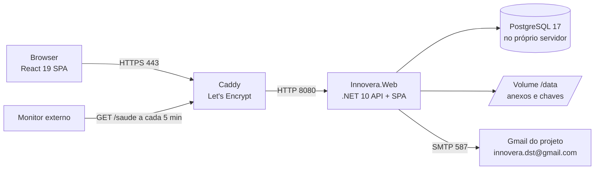

# Innovera — Documentação técnica

Plataforma de gestão da Inovação da dstelecom (Projeto de Informática, Universidade do Minho, 2026/27).
Este documento explica como a aplicação está feita, como se configura, testa e publica. O uso da plataforma está no
**manual do utilizador**, que também está dentro da aplicação (botão **ajuda**, ficheiro `src/Web/ClientApp/src/ajuda/manual.md`).

Outros documentos: [README](../README.md) (instalar e correr no PC) · [modelo de domínio](modelo-dominio.md) ·
[requisitos (RF01–RF16)](requisitos.md) · [publicação na AWS](publicacao-aws.md).

## 1. Visão geral

| | |
| --- | --- |
| Utilizadores | Equipa de Inovação da dstelecom (gestão) e todos os trabalhadores (≈ 277, submetem e discutem ideias) |
| O que substitui | Os modelos Excel do processo de inovação (Mod.52, 69, 235, 236, 237, 238, 239, 241, 246, 252 e o Project Charter) e a Caixa de Inovação |
| Onde corre | Servidor Lightsail da dst (Frankfurt), Ubuntu 24.04, 2 vCPU, 1 GB RAM + 4 GB swap, em https://63.181.134.124.nip.io |
| Arquitetura | Monólito modular (Clean Architecture): uma API .NET que também serve o frontend React |



Tudo corre em contentores Docker (`deploy/docker-compose.producao.yml`): `app` (a aplicação), `bd` (PostgreSQL) e
`caddy` (HTTPS e reencaminhamento).

## 2. Tecnologias e decisões

| Área | Escolha | Porquê |
| --- | --- | --- |
| Backend | .NET 10 (LTS), ASP.NET Core Minimal APIs | Stack livre; LTS até 2028; template Clean Architecture que a equipa já usava |
| Casos de uso | Comandos e consultas com um **mediador próprio** (`Application/Common/Mediacao`) | O MediatR passou a ter licença paga para empresas como a dst; o nosso tem os mesmos nomes (`IRequest`, `ISender`, `IPipelineBehavior`…) |
| Validação | FluentValidation | Validações declarativas por comando, corridas pelo `ValidationBehaviour` |
| Dados | EF Core 10 + Npgsql (PostgreSQL 17) | O Lightsail não tem SQL Server; PostgreSQL é gratuito e simples de alojar no próprio servidor |
| Contas | ASP.NET Core Identity com cookie | Sem integração com os sistemas da dst por agora; convites por email |
| Frontend | React 19 + TypeScript + Vite, sem biblioteca de componentes | Copia o aspeto do site de inovação atual da intranet |
| Excel | Leitor e gerador próprios (`LeitorXlsx`, `GeradorExcel`, só `System.IO.Compression` + XML) | Sem dependências com licença; o leitor também lê as cores das células (Mod.69) |
| Email | SMTP (Gmail do projeto com password de aplicação) | O SES não vai ser usado num projeto universitário; trocar é só mudar 4 variáveis |
| Alojamento | Docker Compose + Caddy num Lightsail | Uma máquina pequena; Caddy trata do certificado HTTPS sozinho |
| Testes | NUnit + Shouldly; PostgreSQL real em Docker (Aspire testing + Respawn); Playwright para E2E | Os testes funcionais correm os casos de uso contra a base de dados verdadeira |

## 3. Estrutura do repositório

```
src/
  Domain/          entidades, enums e regras de negócio (sem dependências)
  Application/     casos de uso: um ficheiro por funcionalidade com o comando/consulta, o validador e o handler
  Infrastructure/  EF Core (DbContext, configurações, migrações), Identity, email, ficheiros, Excel, tarefas em segundo plano
  Web/             arranque (Program.cs), endpoints (Endpoints/), e o frontend em ClientApp/
  AppHost/         .NET Aspire para desenvolvimento (PostgreSQL + Mailpit + API + frontend)
  ServiceDefaults/ configuração comum do Aspire (telemetria, health checks em desenvolvimento)
tests/
  Domain.UnitTests/            regras do domínio
  Application.UnitTests/       mediador, comportamentos, gerador de Excel
  Application.FunctionalTests/ casos de uso contra PostgreSQL em Docker
  e2e/                         testes no browser (Playwright) contra a imagem de produção
deploy/            Dockerfile, docker-compose (produção, servidor, E2E), Caddyfile, .env.exemplo, backup.sh
docs/              esta documentação, modelo de domínio, requisitos, publicação
```

## 4. Camadas e fluxo de um pedido

1. O **frontend** chama a API (`src/Web/ClientApp/src/api/servicos.ts`) com o cookie de sessão.
2. O **endpoint** (`src/Web/Endpoints/<Grupo>.cs`, rota `/api/<Grupo>/…`) só traduz o pedido HTTP num comando ou consulta e envia-o pelo `ISender`.
3. O **mediador** passa o pedido pelos comportamentos, por esta ordem (o primeiro é o mais exterior):
    - `LoggingBehaviour` — regista o pedido;
    - `UnhandledExceptionBehaviour` — regista erros inesperados;
    - `AuthorizationBehaviour` — aplica `[Authorize]` / `[Authorize(Permissao = …)]` do pedido;
    - `ValidationBehaviour` — corre os validadores FluentValidation;
    - `PerformanceBehaviour` — avisa nos registos quando um pedido demora mais de 500 ms.
4. O **handler** (Application) usa o `IApplicationDbContext` e os serviços da Infrastructure através de interfaces.
5. Ao gravar, os **interceptores** do EF Core publicam os eventos de domínio (ex.: lição registada → aviso à equipa; relatório de milestone → entrada no Mod.237), preenchem as datas de auditoria e escrevem o registo de auditoria.
6. Os erros viram respostas HTTP no `ProblemDetailsExceptionHandler` (validação 400, sem permissão 403, não encontrado 404, regra de negócio 400 com a mensagem).

O frontend é servido pela própria API (`wwwroot`, com `MapFallbackToFile("index.html")` para as rotas do React).

## 5. Modelo de dados

Detalhe em [modelo-dominio.md](modelo-dominio.md). Pontos principais:

- **Ideia** — ciclo próprio (validação dos autores → validação da equipa → discussão de 30 dias → avaliação → decisão e classe); código AA01…ZZ99 gerado por uma sequência PostgreSQL (`ideia_numero_seq`); guarda o n.º da Caixa de Inovação quando é importada.
- **Iniciativa** — uma tabela com discriminador (TPH) para os 7 tipos (Projeto, Desafio, MelhoriaContinua, Oportunidade, Vigilancia, Mestrado, AcaoInovacao); códigos PRJ/DES/MC/OPO/VIG/MES/ACA-nnn. Projetos e desafios têm **ProjectCharter** (tarefas WBS, entregas, riscos, orçamento, conformidade, lições, equipa e alocação mensal).
- **Registos** — Parceiro/AcordoParceria (Mod.235), AtivoIntangivel (236), ConhecimentoCodificado (237), ConhecimentoTacito (238), FerramentaMetodo com análises anuais (241), LinhaEstrategia (52), AtividadePlanoAnual (69). As listas pequenas (atividades · quem · quando, análises anuais) são coleções próprias da entidade.
- **KPIs** — o catálogo dos 41 indicadores está no código (`CatalogoKpi`); a base de dados guarda por KPI, ano e período o objetivo, as ações do plano e os valores oficiais importados do Mod.239. Os valores externos (trabalhadores, receitas, proveitos) são introduzidos à mão.
- **Transversais** — Utilizador (ligado à conta Identity), Notificação, Alerta (para avisar uma só vez), RegistoAuditoria, LinkDocumento (OneDrive).

As migrações estão em `src/Infrastructure/Data/Migrations` e aplicam-se sozinhas no arranque (`InitialiseDatabaseAsync`), que também cria os perfis do sistema, a conta inicial de Administrador e, com `DadosExemplo = true`, os dados de demonstração.

## 6. Segurança

- **Contas:** sem registo livre. O Administrador adiciona a pessoa e ela define a password num link de convite (3 dias). Passwords com pelo menos 8 caracteres, maiúscula, minúscula e algarismo; 5 tentativas erradas bloqueiam 15 minutos; só entra quem confirmou o email.
- **Perfis e permissões:** cada pessoa tem **um só perfil** (Administrador, Equipa de Inovação, Trabalhador ou um perfil criado no backoffice). Os casos de uso pedem permissões (`Permissoes.cs`), nunca perfis; as permissões de cada perfil estão na base de dados (role claims) e mudam-se no backoffice.
- **Dados sensíveis:** o orçamento e os KPIs 38–41 só para quem tem `orcamento.ver`; o conhecimento tácito de confidencialidade elevada só para quem gere os registos; ideias privadas só para os autores e a equipa.
- **Auditoria:** todas as criações, alterações e eliminações ficam em `RegistosAuditoria` (quem, quando, campos antes/depois), visíveis com `auditoria.ver`.
- **Transporte:** HTTPS com certificado Let's Encrypt (Caddy), HSTS; a aplicação confia nos cabeçalhos `X-Forwarded-*` do Caddy.
- **Segredos:** só no `.env` do servidor (`/opt/innovera/deploy/.env`, permissões 600) — nunca no git. Os dados reais da dst (Excel) também nunca vão para o git.
- **Ficheiros:** anexos e relatórios até 25 MB, guardados no volume `/data/ficheiros` e servidos só a quem pode ver o registo; as chaves de cifra dos cookies ficam em `/data/chaves` (sobrevivem às atualizações).

## 7. Funcionalidades transversais

| Funcionalidade | Onde está | Notas |
| --- | --- | --- |
| Avisos e emails | `ServicoNotificacoes`, `EmailSmtp` | Sino na aplicação + email; sem `Smtp:Host` o email fica só nos registos |
| Tarefas em segundo plano | `Infrastructure/Jobs` | De hora a hora: fecha as discussões de 30 dias (`FecharDiscussoesJob`) e gera os alertas (`AlertasJob` → `GerarAlertasCommand`): plano anual, validades dos ativos (90 dias), vigilâncias e atividades (7 dias), prazos e atrasos do Project Charter (7 dias antes; atrasos até 30 dias). A tabela `Alertas` garante que cada aviso só sai uma vez |
| Importar modelos | `Application/Importacoes`, `LeitorXlsx` | Reconhece o modelo pelos cabeçalhos; repetível (chaves naturais por modelo); o Mod.69 lê as cores de fundo (incluindo cores do tema com tint e gradientes) e a legenda; o Mod.246 usa `ImportarPortefolioCommand` |
| Exportar Excel | `Application/Exportacoes`, `GeradorExcel` | `GET /api/Exportacoes/{modelo}`; reutiliza as consultas das páginas |
| KPIs | `Application/Kpis` | `CalculoKpi` calcula por ano/semestre a partir dos registos; nos períodos fechados prevalece o valor oficial importado; evolução anual por KPI (`/api/Kpis/{n}/evolucao`) |
| Ideias parecidas | `Ideias/Queries/IdeiasParecidas.cs` | Coeficiente de Dice sobre as palavras do título (sem acentos, plurais e palavras vazias); aviso a partir de 50% |
| Ajuda | `ClientApp/src/ajuda/manual.md`, `paginas/Ajuda.tsx` | O botão ajuda abre a secção do manual que corresponde à página atual |
| Saúde | `GET /saude` | 200 `Healthy` se a aplicação responde e chega à base de dados; 503 `Unhealthy` caso contrário |

## 8. Configuração

No servidor, tudo vem do `.env` lido pelo Docker Compose (ver `deploy/.env.exemplo`):

| Variável (.env) | Configuração .NET | Para quê |
| --- | --- | --- |
| `DOMINIO` | `Email:UrlSite` (https://DOMINIO) | Domínio do site (Caddy e links dos emails) |
| `LIGACAO_BD` | `ConnectionStrings:InnoveraDb` | Ligação ao PostgreSQL |
| `BD_LOCAL_PASSWORD` | — | Password do contentor `bd` |
| `ADMIN_EMAIL`, `ADMIN_PASSWORD` | `ContaAdministrador:*` | Conta de Administrador criada no primeiro arranque |
| `DADOS_EXEMPLO` | `DadosExemplo` | `true` só em servidores de teste |
| `EMAIL_REMETENTE`, `EMAIL_NOME` | `Email:Remetente`, `Email:NomeRemetente` | Quem envia os emails |
| `SMTP_HOST`, `SMTP_PORTA`, `SMTP_SSL`, `SMTP_UTILIZADOR`, `SMTP_PASSWORD` | `Smtp:*` | Servidor de email (hoje o Gmail do projeto) |

A imagem define ainda `Armazenamento__Pasta=/data/ficheiros` e `DataProtection__Pasta=/data/chaves`.
Em desenvolvimento a configuração está em `src/Web/appsettings.Development.json` (Mailpit, dados de exemplo).

## 9. Desenvolvimento

Ver o [README](../README.md): `dotnet run --project src/AppHost` com o Docker aberto arranca tudo (PostgreSQL, Mailpit, API e frontend) com dados de exemplo.

Convenções:

- Um caso de uso = um ficheiro em `Application/<Área>/` com o pedido (`record … : IRequest<T>`), o validador e o handler; o endpoint fica em `Web/Endpoints/<Área>.cs` com um nome de método único.
- Os textos para o utilizador estão em português de Portugal; o código e os comentários também.
- Alterar o modelo → `dotnet ef migrations add <Nome> --project src/Infrastructure --startup-project src/Web --output-dir Data/Migrations`.
- O build trata avisos como erros (`TreatWarningsAsErrors`).

## 10. Testes

| Tipo | Onde | Como correr | O que cobre |
| --- | --- | --- | --- |
| Unitários do domínio | `tests/Domain.UnitTests` | `dotnet test tests/Domain.UnitTests` | Código AA01, ciclo da ideia, nota do Mod.246, riscos, ocorrências do plano anual… |
| Unitários da aplicação | `tests/Application.UnitTests` | `dotnet test tests/Application.UnitTests` | Mediador e comportamentos, gerador/leitor de Excel |
| Funcionais | `tests/Application.FunctionalTests` | `dotnet test tests/Application.FunctionalTests` (Docker aberto) | Todos os casos de uso contra PostgreSQL real: ideias, Charter, registos, KPIs, importação, permissões, alertas |
| Importação dos Excel reais | o teste `ImportarModelosReaisTests` | variável `INNOVERA_MODELOS_DST` com a pasta dos Excel | Importa os modelos reais numa base de dados de teste (sem a variável é ignorado) |
| E2E no browser | `tests/e2e` (Playwright) | ver abaixo | Login, ciclo de uma ideia, avaliação → projeto, Charter, KPIs e gráfico, vigilâncias, exportar, ajuda, administração |

**E2E:** constroem a imagem de produção e arrancam-na no PC com uma base de dados descartável e os dados de exemplo:

```bash
docker build -f deploy/Dockerfile -t innovera:e2e .
docker compose -p innovera-e2e -f deploy/docker-compose.producao.yml -f deploy/docker-compose.e2e.yml \
  --env-file deploy/e2e.env --profile bd-local up -d app bd
cd tests/e2e && npm install && npx playwright install chromium && npx playwright test
docker compose -p innovera-e2e -f deploy/docker-compose.producao.yml -f deploy/docker-compose.e2e.yml --env-file deploy/e2e.env down -v
```

O relatório fica em `tests/e2e/relatorio` (com o ecrã e o trace dos testes que falharam).

## 11. Publicação e operação

**Publicar uma versão nova** (do PC de quem tem acesso ao servidor): `publicar_servidor.bat` constrói a imagem Docker no PC,
envia-a por SSH para o servidor e corre `preparar.sh`, que carrega a imagem e faz `docker compose up -d`. As migrações
aplicam-se no arranque. O `.env` do servidor não é tocado.

**Comandos úteis no servidor** (pasta `/opt/innovera/deploy`):

```bash
C="sudo docker compose -f docker-compose.producao.yml -f docker-compose.servidor.yml --env-file .env --profile bd-local"
$C ps                     # estado dos contentores
$C logs --tail 100 app    # registos da aplicação
$C restart app            # reiniciar a aplicação
$C up -d                  # aplicar alterações do .env
```

**Monitorização:** um monitor externo gratuito (UptimeRobot) pede `https://63.181.134.124.nip.io/saude` a cada 5 minutos e
envia um email quando a resposta não é `Healthy` (site em baixo ou sem base de dados) e outro quando volta.
Os contentores têm `restart: unless-stopped`, por isso voltam sozinhos depois de um reinício do servidor.

**Cópias de segurança:** por decisão da equipa não há cópias automáticas (a base de dados vive só no servidor e não se
guardam dados da dst nos PCs). O script `deploy/backup.sh` fica disponível se a dst quiser ativá-las mais tarde.

**Limitações conhecidas:** 1 GB de RAM (a imagem é construída no PC, não no servidor); endereço provisório nip.io até
haver um subdomínio da dst; emails enviados pelo Gmail do projeto (limite diário do Gmail, suficiente para o uso atual);
RF13 (relatório semestral/anual automático) por decidir.
